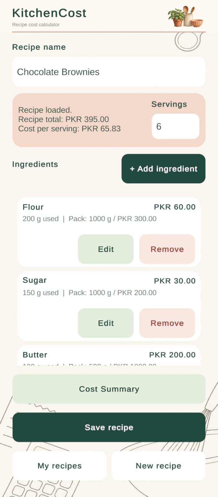
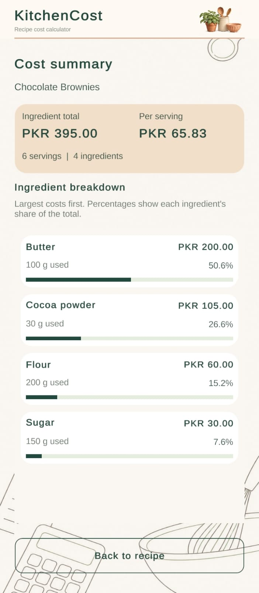
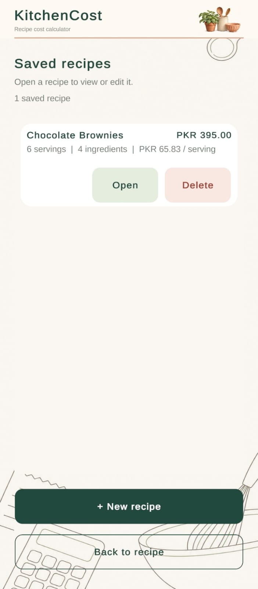

# KitchenCost

An offline Android app for calculating recipe ingredient costs, built with **Unity and C#**. Enter the quantity used, pack size and pack price to see what each ingredient contributes to a recipe and how much each serving costs.

**Android · Unity 2022.3 LTS · C# · TextMeshPro · Local JSON storage**

## See it in action

[Watch the 61-second Android demo](docs/media/KitchenCost-Demo.mp4)

The recording opens a saved recipe, edits an ingredient, shows the updated cost breakdown, and saves and reopens the result.

| Recipe editor | Cost breakdown | Saved recipes |
| --- | --- | --- |
|  |  |  |

These are captures of the working app, with its larger touch controls and white kitchen line-art background.

## What it does

- Calculate each ingredient's cost from the portion of a pack used.
- Add, edit and remove ingredients; cancel an edit without changing the original.
- Show the recipe total and update the per-serving cost when servings change.
- Save, open, update and delete multiple recipes on the device.
- Show a cost breakdown, sorted from largest cost to smallest, with percentage bars.
- Validate quantities, prices and servings; confirm deletion and discarding unsaved changes.

## Example calculation

```text
Ingredient cost = (quantity used / pack quantity) × pack price
Recipe total = sum of ingredient costs
Cost per serving = recipe total / servings
```

The screenshots use **Chocolate Brownies**, with six servings:

| Ingredient | Used (g) | Pack size (g) | Pack price (PKR) | Cost (PKR) |
| --- | ---: | ---: | ---: | ---: |
| Flour | 200 | 1000 | 300 | 60.00 |
| Sugar | 150 | 1000 | 200 | 30.00 |
| Butter | 100 | 500 | 1000 | 200.00 |
| Cocoa powder | 30 | 100 | 350 | 105.00 |

**Total: PKR 395.00 · Per serving: PKR 65.83**

In the video, Flour changes from 200 g to 250 g. Its cost becomes PKR 75.00, the recipe total becomes **PKR 410.00**, and the per-serving cost becomes **PKR 68.33**. The difference between the video and screenshots is intentional.

These are sample costing inputs, not current market prices or a complete baking recipe.

## Implementation

| Script | Responsibility |
| --- | --- |
| `KitchenCostCalculator.cs` | Recipe state, input validation, decimal calculations, ingredient editing, saving/loading and screen transitions |
| `KitchenCostIngredientRow.cs` | Ingredient cards with Edit/Remove actions, reused for saved-recipe cards with Open/Delete |
| `KitchenCostRecipeBrowser.cs` | Saved recipe list and confirmation dialogs |
| `KitchenCostSummaryScreen.cs` | Read-only totals, ingredient breakdown and percentage bars |

The interface uses uGUI, RectTransforms, ScrollRects and TextMeshPro. The scene contains the recipe editor and ingredient form; the saved recipe browser and cost summary are built at runtime.

Calculations use C# `decimal`, with rounding applied for display. Quantities and pack sizes must be positive; pack prices can be zero. Servings must be a positive whole number.

Recipes use `JsonUtility` and `PlayerPrefs` for local storage. Decimal quantities and prices are serialized as invariant strings. Stable recipe IDs allow an opened recipe to be updated. The app requires an explicit **Save recipe** action.

## Design and validation

The layout was refined through Unity and Android phone checks. Small controls were enlarged after device feedback, and the visual design was simplified to readable cards, large buttons and restrained kitchen line art.

Manual checks covered calculation, editing/removal, saving/opening, cost breakdowns and screen layout. The included recording demonstrates the edit → recalculate → save → reopen flow. Broad device compatibility and automated regression coverage are not claimed.

## Run locally

1. Clone or download the full repository, including `Assets`, `Packages` and `ProjectSettings`.
2. Add the project folder in Unity Hub and use the editor version specified in `ProjectSettings/ProjectVersion.txt`.
3. Allow packages and assets to import, then open the **KitchenCost_Comfort** scene.
4. Press Play.

For an APK, install the matching editor's Android Build Support. In **File → Build Settings**, select Android and include **KitchenCost_Comfort** as the startup scene. Disable **Export Project** and **Build App Bundle (Google Play)**, then build to a folder outside `Assets`.

## Current scope

This version labels quantities in **grams** and prices in **PKR**. It has no unit selector or unit conversion. Support for `g`, `ml` and `pcs` is a planned improvement.

The app estimates ingredient costs only. Labour, packaging, utilities, profit margins, cloud sync and recipe export are outside this version's scope. Recipes are stored locally, without an in-app backup facility.

KitchenCost is a portfolio project demonstrating C# application logic, mobile UI, local persistence and iteration based on device testing.
